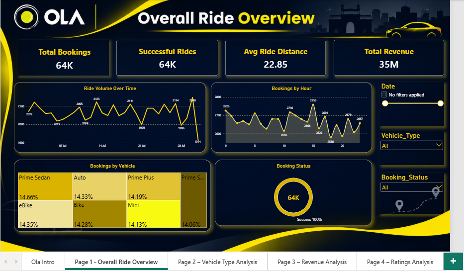
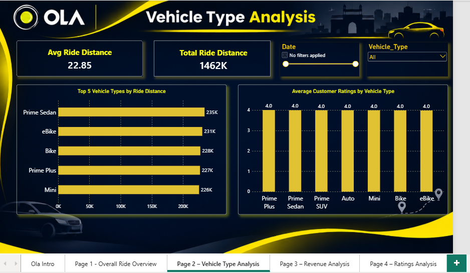
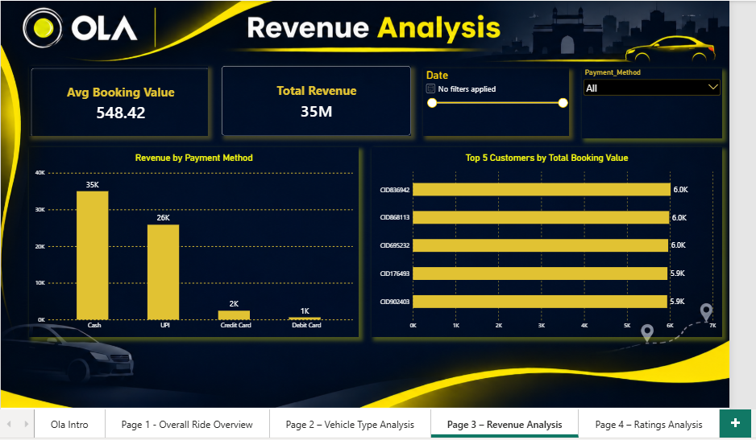
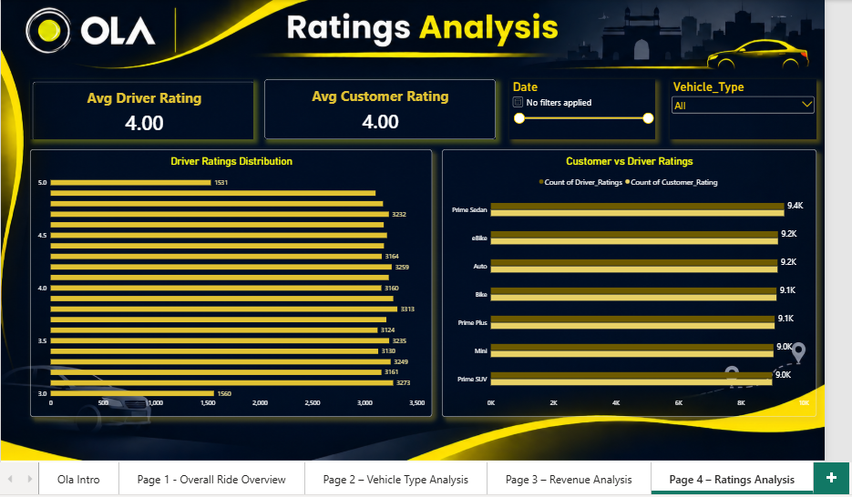
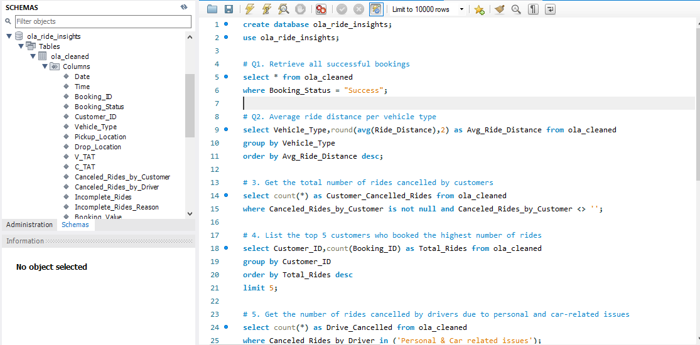
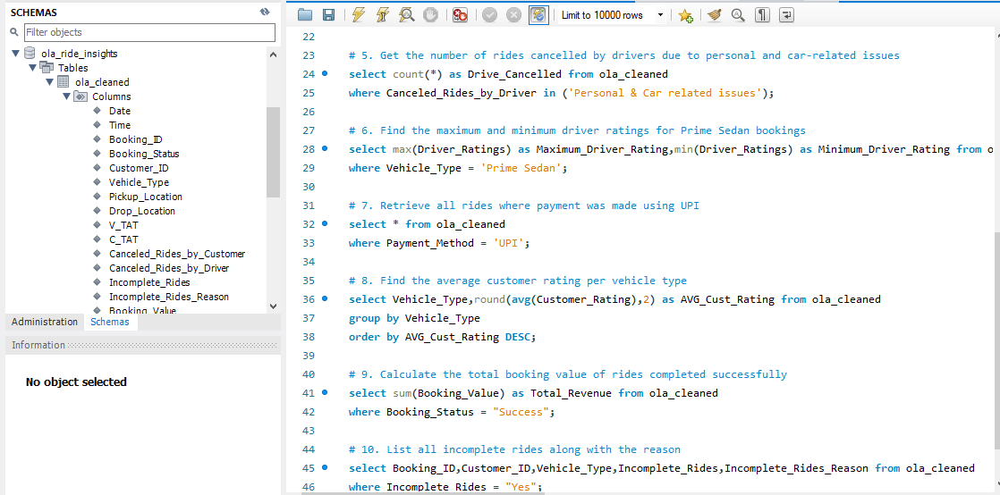

# 🚕 OLA Ride Insights | Data Analytics Project

<p align="center">
  
  
  
  
</p>

<p align="center">
  **Analyzing Ride Booking Trends, Revenue, Vehicle Performance & Customer Experience**
</p>

<p align="center">
  
  
  
  
  
  
</p>

## 📌 Project Overview

OLA Ride Insights is an end-to-end data analytics project focused on analyzing ride-booking data to uncover meaningful business insights.

The project explores booking trends, vehicle performance, revenue patterns, ride distances, and customer and driver ratings using Python, MySQL, and Power BI.

The objective is to transform raw ride-booking data into actionable insights that can help improve operational efficiency, understand customer behavior, and support data-driven business decisions.

## 🎯 Business Objectives

- Analyze overall ride-booking trends and booking status.
- Identify peak booking hours and demand patterns.
- Understand vehicle-type performance and ride distances.
- Analyze revenue generated through different payment methods.
- Identify high-value customers.
- Evaluate customer and driver ratings.
- Highlight opportunities to improve ride availability and customer experience.

## 📊 Dataset Overview

| Metric | Value |
|---|---:|
| Total Records | 103,024 |
| Total Columns | 20 |
| Duplicate Records | 0 |
| Rows Removed During Cleaning | 0 |
| Dataset Period | July |

**Important dataset fields:**
- Booking_ID
- Booking_Status
- Customer_ID
- Vehicle_Type
- Pickup_Location
- Drop_Location
- Booking_Value
- Payment_Method
- Ride_Distance
- Driver_Ratings
- Customer_Rating

## 🛠️ Tools & Technologies

| Tool | Purpose |
|---|---|
| Python | Data analysis and preprocessing |
| Pandas | Data manipulation and cleaning |
| NumPy | Numerical operations |
| Matplotlib | Data visualization |
| Seaborn | Statistical visualization |
| MySQL | Business queries and analysis |
| Power BI | Interactive dashboards |
| DAX | KPI calculations and measures |
| Jupyter Notebook | EDA and analysis workflow |

## 🔄 Project Workflow

1. **Data Understanding:** Explored the dataset structure, columns, and business requirements.
2. **Data Cleaning:** Checked missing values, duplicates, and data types.
3. **Exploratory Data Analysis:** Analyzed booking trends, vehicle types, revenue, distances, and ratings.
4. **SQL Analysis:** Developed SQL queries to answer business questions.
5. **Power BI Development:** Built interactive dashboards with KPIs, charts, and slicers.
6. **Business Insights:** Identified trends and opportunities from the analysis.

## 📈 Power BI Dashboard

The Power BI report contains four analytical pages.

### 1. Overall Ride Overview

Provides a high-level view of OLA ride-booking performance.

**Key Metrics:**
- Total Bookings
- Successful Rides
- Average Ride Distance
- Total Revenue

**Visualizations:**
- Ride Volume Over Time
- Bookings by Hour
- Bookings by Vehicle Type
- Booking Status Breakdown



### 2. Vehicle Type Analysis

Analyzes ride distance and customer ratings across vehicle categories.

**Key Metrics:**
- Average Ride Distance
- Total Ride Distance

**Visualizations:**
- Top 5 Vehicle Types by Ride Distance
- Average Customer Ratings by Vehicle Type



### 3. Revenue Analysis

Explores revenue patterns and customer booking value.

**Key Metrics:**
- Average Booking Value
- Total Revenue

**Visualizations:**
- Revenue by Payment Method
- Top 5 Customers by Total Booking Value



### 4. Ratings Analysis

Evaluates customer and driver ratings to understand ride experience.

**Key Metrics:**
- Average Driver Rating
- Average Customer Rating

**Visualizations:**
- Driver Ratings Distribution
- Customer vs. Driver Ratings



## 🗄️ SQL Analysis

Developed 10 SQL queries to answer important business questions:

1. Retrieve all successful bookings.
2. Calculate average ride distance for each vehicle type.
3. Find the total number of customer-cancelled rides.
4. Identify the top 5 customers by number of rides.
5. Analyze driver cancellations due to personal and car-related issues.
6. Find maximum and minimum driver ratings for Prime Sedan bookings.
7. Retrieve rides paid through UPI.
8. Calculate average customer ratings by vehicle type.
9. Calculate total booking value of successful rides.
10. Retrieve incomplete rides along with their reasons.

SQL scripts are available in the `sql/` directory.



## 📌 Key EDA Metrics

| Metric | Result |
|---|---:|
| Total Bookings | 103,024 |
| Successful Rides | 63,967 |
| Total Revenue | 35,080,467 |
| Average Booking Value | 548.42 |
| Average Ride Distance | 22.85 |
| Average Customer Rating | 4.00 |
| Average Driver Rating | 4.00 |

*These are dataset-level EDA results; dashboard filters may change displayed values.*

## ⚠️ Data Limitations

The provided dataset contains empty values in the `Canceled_Rides_by_Customer` and `Canceled_Rides_by_Driver` columns. Therefore, detailed cancellation-reason analysis was not included in the final Power BI report to avoid presenting unsupported insights.

## 📂 Repository Structure

```text
ola-ride-analytics-dashboard/
│
├── data/
├── notebooks/
├── sql/
├── powerbi/
├── screenshots/
├── requirements.txt
└── README.md
```

## 🚀 How to Explore This Project

1. Clone this repository.
2. Open the Jupyter Notebook inside `notebooks/`.
3. Install the required Python libraries.
4. Execute the SQL scripts using MySQL Workbench.
5. Open the Power BI report from the `powerbi/` directory.

### Clone Repository

```bash
git clone https://github.com/YOUR-USERNAME/ola-ride-analytics-dashboard.git

cd ola-ride-analytics-dashboard
```

### Install Dependencies

```bash
pip install -r requirements.txt
```

## 👨‍💻 Author

**Mohd Nasrullah Siddiqui**

<p align="center">
  ⭐ If you find this project useful, consider giving it a star!
</p>

<p align="center">
  **Turning Raw Data into Meaningful Business Insights.**
</p>
